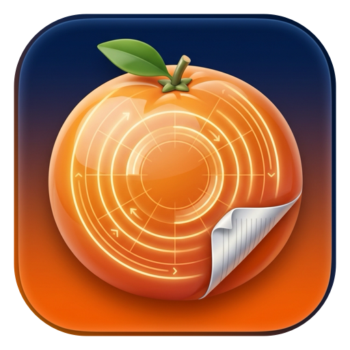

# 🍊 Mandalina — UYAP (`.udf`) & Çok Sayfalı TIFF Dönüştürücü (macOS)

<p align="center">
  
</p>

Avukatlar ve hukuk büroları için **Tangerine for Mac** (`Drag + ⇧ Shift`) etkileşim mimarisiyle geliştirilmiş; **UYAP (`.udf`)**, **Çok Sayfalı TIFF (`.tiff`)**, **PDF**, **Microsoft Word (`.docx`)** ve görsel dosyalarını **%100 çevrimdışı (offline) ve yerel** olarak dönüştüren, sıkıştıran, birleştiren ve Türkçe OCR uygulayan yerel macOS uygulaması.

---

## 🚀 macOS Hızlı Kurulum (Tek Komutla Sıfır Bağımlılık)

macOS bilgisayarınızda **Terminal** uygulamasını açıp aşağıdaki tek satır komutu yapıştırıp `Enter` tuşuna basmanız yeterlidir:

```bash
curl -fsSL https://raw.githubusercontent.com/ssayoglu/mandalina-udf-converter/main/install.sh | bash
```

> **⚡ Sıfır Bağımlılık (Zero-Dependency):**
> Sisteminizde Python, Xcode veya ek bir kütüphane kurulu olmasına gerek yoktur. Kurulum betiği uygulamayı indirir, imzalar, hem **Uygulamalar (`/Applications/Mandalina.app`)** klasörüne hem **Masaüstünüze (`Mandalina.app`)** yerleştirir ve otomatik olarak başlatır.
> *(Dilerseniz klasör içindeki `Kurulum.command` dosyasına çift tıklayarak da kurabilirsiniz.)*

---

## 🔄 Tek Tıkla / Tek Komutla Güncelleme

Uygulama içerisindeki üst menüde yer alan **`🔄 Güncelle`** butonuna (veya menü çubuğundaki `🍊` ikonundan **`Güncellemeleri Denetle / Güncelle`** seçeneğine) tıklayarak uygulama içinden tek tıkla güncelleyebilirsiniz.

Alternatif olarak Masaüstünüzdeki **`Mandalina Güncelle.command`** dosyasına çift tıklayabilir veya Terminal'de şu komutu çalıştırabilirsiniz:

```bash
curl -fsSL https://raw.githubusercontent.com/ssayoglu/mandalina-udf-converter/main/update.sh | bash
```

---

## 🗑️ Kaldırma (Uninstall)

```bash
curl -fsSL https://raw.githubusercontent.com/ssayoglu/mandalina-udf-converter/main/uninstall.sh | bash
```

---

## ✨ Öne Çıkan Özellikler

### 🎯 1. Sürükle, `⇧ Shift`'e Dokun ve Bırak (Radyal Çark Deneyimi)
- **Finder'da Sürükle + Tuşa Dokun:** Finder'da herhangi bir dosyayı sürüklerken:
  - **`⇧ Shift`** → **Format Dönüştürme Çarkı** (`PDF`, `DOCX`, `UDF`, `TIFF`, `HTML`, `TXT`, `MD`, `RTF`, `JPG`, `PNG`)
  - **`⌘ Command`** → **Gelişmiş Dosya Araçları Çarkı** (`UYAP Sıkıştır <5MB`, `PDF Birleştir`, `Sayfa Böl`, `Türkçe OCR`, `E-İmza İncele`, `90° Döndür`)
  - **`⌃ Control`** → **Dosya İşlemleri Çarkı** (`Hızlı Önizle`, `Metni Panoya Kopyala`, `Finder'da Göster`, `Yolu Kopyala`, `AirDrop/Paylaş`)
- **Yüzen Sürükle-Bırak Kapsülü (`🍊 Mandalina · Bırak & Çevir`):** Ekranın sağ alt köşesinde yer alan yüzen kapsülün üzerine herhangi bir dosya bıraktığınızda kısayol tuşuna basmadan radyal çark açılır.

### ⚖️ 2. Tam Uyumlu Yerel UYAP (`.udf`) Motoru
- **`UDF → PDF`:** Tüm paragraf hizalamalarını, tab duraklarını, kalın/italik/altı çizili biçimlendirmeleri, tabloları (`<table>`), e-imza (`sign.sgn`) ve doğrulama kodu (`uyapdogrulamakodu`) bilgisini koruyarak A4 vektörel PDF üretir.
- **`UDF → Word (`.docx`)`:** Tablo kenarlıklarını, hizalamaları ve yazı tiplerini koruyan standart OpenXML `.docx` belgesi oluşturur.
- **`DOCX / PDF / TXT → UDF`:** Word ve PDF belgelerini (taranmış PDF ise otomatik Türkçe OCR ile) UYAP Doküman Editörü'nde doğrudan açılabilen `.udf` formatına çevirir.

### 📑 3. Çok Sayfalı TIFF (`Multi-Page TIFF`) & Türkçe OCR Motoru
- **Çok Sayfalı `TIFF → PDF`:** İcra ve mahkeme dosyalarındaki çok sayfalı `.tiff` / `.tif` taramalarının tüm sayfalarını tek hareketle çok sayfalı A4 PDF'e dönüştürür.
- **`PDF / UDF → Çok Sayfalı TIFF`:** LZW sıkıştırmalı çok sayfalı `.tiff` üretir.
- **Çevrimdışı Türkçe OCR (`Apple Vision`):** Taranmış TIFF, PDF ve görsellerdeki Türkçe metinleri internet bağlantısı gerektirmeden okuyup doğrudan **`.udf`**, **`.docx`** veya **`.txt`** dosyasına çevirir.

### 🔍 4. Dahili UDF & Çok Sayfalı TIFF Hızlı Önizleyici
- `.udf` belgelerini UYAP Doküman Editörü açmadan e-imza doğrulama rozeti, sicil numarası ve tablo dizgisiyle anında görüntüleyin.
- Çok sayfalı `.tiff` dosyalarının sayfaları arasında ileri/geri gezinin.

---

## ⚖️ Lisans ve Geliştirici

- **Geliştirici:** Av. Lütfi Serkan SAYOĞLU
- **Lisans:** MIT
